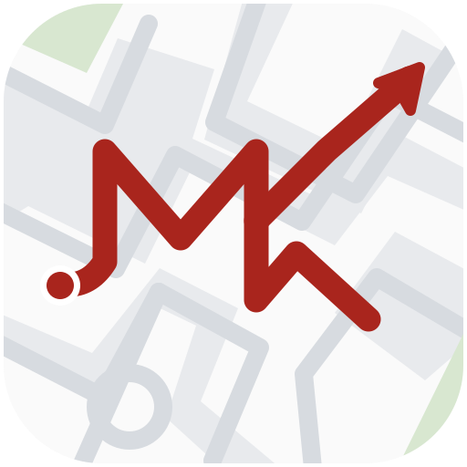

# MK Redway Navigator

Find your way around Milton Keynes on foot or by bike, with the Redway network at the heart of your journey.

Plan a trip, compare routes and follow directions on your phone. MK Redway Navigator runs in your browser, can be added to your Home Screen and needs no account.

**[Open MK Redway Navigator → mkredway.co.uk](https://mkredway.co.uk)**

The app is an independent project, currently in **beta**. Feedback from people walking and cycling in MK helps make it more reliable for everyday journeys.

## Plan your first journey

1. **Find your destination.** Search for a place, address or postcode, then choose a result and check its position on the map.
2. **Tap Directions.** Use your location as the start, or select the starting field to choose somewhere else.
3. **Choose your route.** Switch between Cycle and Walk. For cycling, compare the route options, estimated time and how much of the journey uses Redways or roads.
4. **On your phone, tap Start.** Allow location access for live navigation. Voice guidance and automatic rerouting are available along the way.

Want to start at a particular entrance or meeting point? Select the starting field, choose **Choose on map**, then drag or zoom the map and tap your point. Close the picker to cancel. You can choose both endpoints manually and plan without using GPS.

Search covers the app's Milton Keynes map area, rather than every MK postcode or the whole council area. Some addresses and house numbers are missing from the map; a building or street match may be approximate. Check the pin and choose the entrance you actually need.

## Pick the route that suits you

| Cycling preference | What it favours |
| --- | --- |
| **Maximum Redway** | More use of paths classified as Redway routes. |
| **Balanced** | A balance between Redway preference and distance. |
| **Fastest** | A more direct route, with less emphasis on staying on Redways. |

You can also turn on **Prefer lit paths** or **Prefer Super Routes**. These are preferences based on available mapping, so a route may still include roads, unlit paths or stretches where lighting is unknown.

Route details help you compare distance, time, road use, crossings and underpasses. Mapping and estimates can be incomplete: check current access, closures and conditions, especially where an approach to an entrance is marked as unverified. If a pin is too far from a usable path, choose a closer entrance.

## Keep your regular places handy

Open **Saved** to set Home, Work and favourite places. Find them with a search or use **Choose on map** to drop a pin. Saved places appear as shortcuts for your next journey.

In **Settings**, you can change voice guidance, distance units and the theme. You can also choose your map icon: **Red dot, Arrow, Cyclist or Concrete Cow**.

Places and settings stay in the browser where you saved them; they do not sync between devices.

## Take MK offline

Before travelling without signal, open **Settings → Offline Milton Keynes → Download** while you have an internet connection. Wait until it says **Ready for offline journeys**.

With the files downloaded, you can browse the MK map, plan local routes, use saved places and search the mapped local places and addresses offline. Online search results, external route guides and advertising still need a connection.

Your device can clear browser storage, so check the offline status before heading out. Downloading the map is separate from adding the app to your Home Screen.

## Add it to your Home Screen

Open **Settings → Install app → Install** for your device's installation steps. On iPhone, use Safari's Share menu and choose **Add to Home Screen**. Supported Android browsers offer an **Install** or **Add to Home Screen** option.

For navigation, keep the app visible and the screen awake. In particular, iOS may pause location updates or speech when you switch apps or lock the screen.

## Plan on a computer, follow on your phone

On desktop, **Send to phone** opens a panel with your route link:

1. Choose **Copy link**, or **Share link** if your browser supports it.
2. Send the link to yourself using a messaging or email app.
3. Open it on your phone, check the route and tap **Start**.

If automatic copying is unavailable, the panel keeps the link available for manual copying. The link includes your start, destination and preferences; the phone calculates the route using its available map data, so the exact route can vary.

For imported or Cultural Route tracks, use **Download GPX** or supported **Share GPX** instead. Send the file to your phone and open **Explore → Import a GPX route** to follow it as an unverified track.

Cultural Route exports contain the original track. To keep its designated colour and calculate a red joining journey, select that Cultural Route in **Explore** on your phone.

## Explore a different side of MK

Open **Explore** to find the five Cultural Routes published by **Get Around MK**, with links to their official guides. Choose a full route and a starting point to plan how to join it: your joining journey is **red**, while the Cultural Route keeps its own colour.

The supplied shortcut GPX files are segments, rather than complete shorter loops; use the official guide for the full shorter-ride instructions. GPX tracks preserve the supplied route, but their access, path types and conditions have not been verified by this app. You can also import your own GPX route through Explore.

## Help make it better

Found a confusing turn, a missing search result or a button that is awkward to use? **[Report a problem or suggest an improvement on GitHub](https://github.com/tubbygregory/mk-redway-navigator/issues).** Real journeys around MK are especially helpful for finding things that simulated testing can miss.

If you can, include:

- What you were trying to do and what happened.
- Nearby public landmarks for the start and destination, plus your route preference.
- Your device, browser, whether you were online or offline, and the version shown in **Settings → About & Data**.
- A screenshot or screen recording, if it helps explain the problem.

Please leave out precise Home or Work addresses and crop personal details or notifications from screenshots. The aim is to make everyday Redway journeys easier to plan and follow; ideas and feedback are welcome while the beta develops.

## Your data and privacy

- **Saved places and settings stay in this browser.** Routes are calculated on your device; there are no user accounts or application backend.
- **Typing a search stays local.** Submitted online searches go to OpenStreetMap's Nominatim service. Map and route-data downloads contact their hosting providers.
- **Shared links contain journey locations.** Take care when sharing a route that starts or ends somewhere private.
- **The app uses Google AdSense**, with a labelled advertising area at the bottom of Settings. Advertising providers may use cookies or similar identifiers and receive information such as your IP address and page URL. Shared-route URLs can include coordinates. See [how Google uses information](https://policies.google.com/technologies/partner-sites) and [manage personalised ads](https://adssettings.google.com/).

You can find more detail, including map-data dates and offline status, in **Settings → About & Data**.

## About the project

MK Redway Navigator is an independent, open-source project. It is **not an official Milton Keynes City Council service**.

Routing, places and addresses use **© OpenStreetMap contributors**, supplied through Geofabrik. Official route classifications come from **Milton Keynes City Council / Get Around MK**. The basemap uses **Protomaps** and its data contributors. See [data sources and licensing](DATA-LICENCE.md) for the details.

Want to help with the code or run it locally? The **[developer guide](docs/DEVELOPMENT.md)** covers setup, testing, routing data, advertising configuration and deployment. You can also read the [changelog](CHANGELOG.md).

Application code is [MIT licensed](LICENSE). Map data and bundled third-party libraries retain their own licences.
